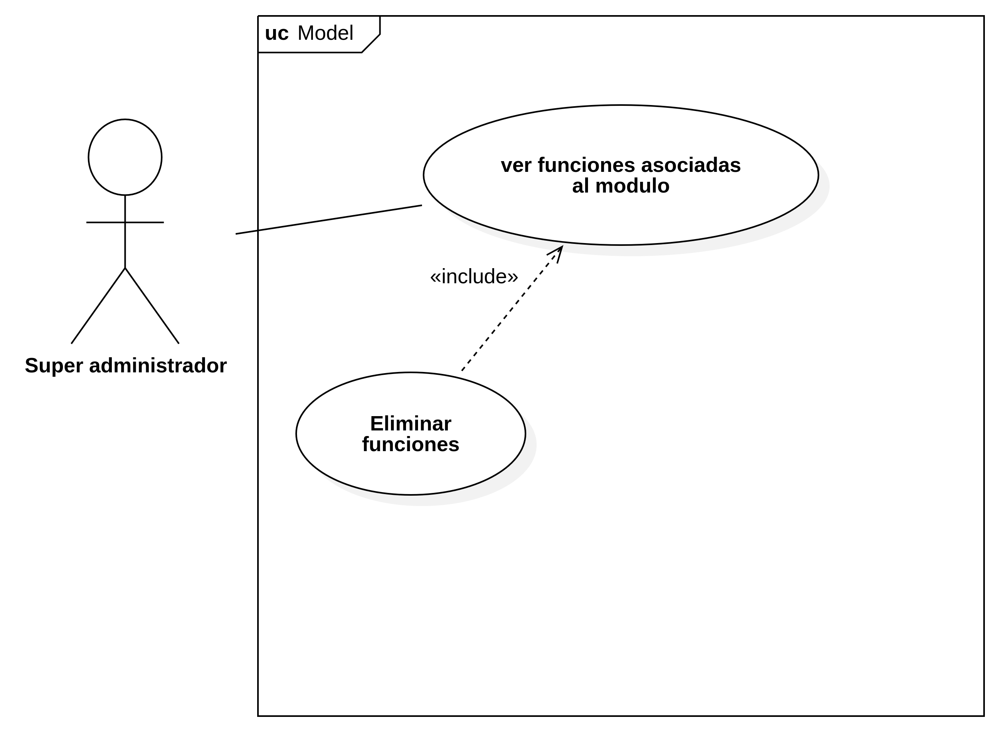
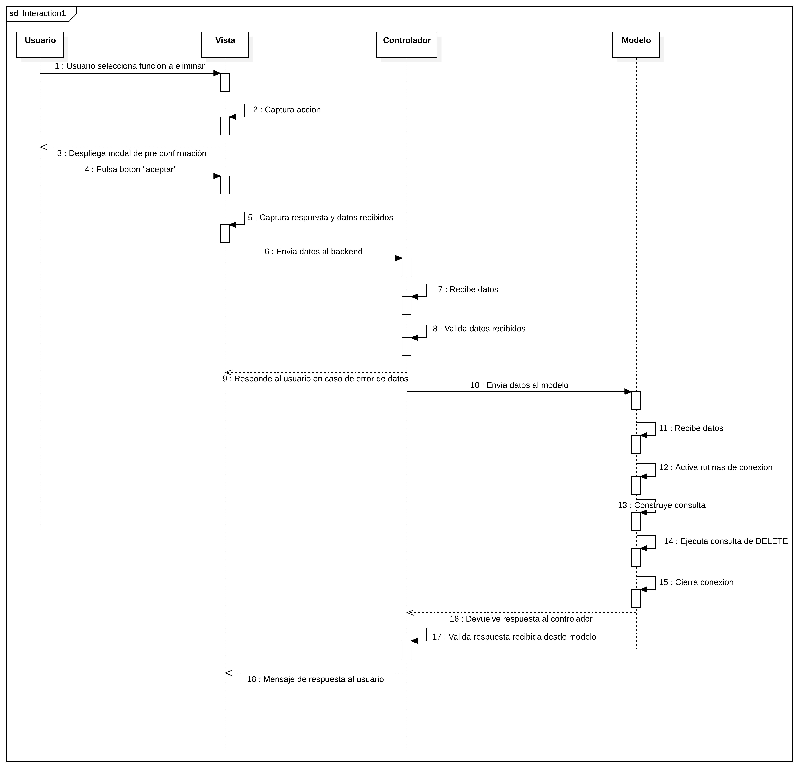
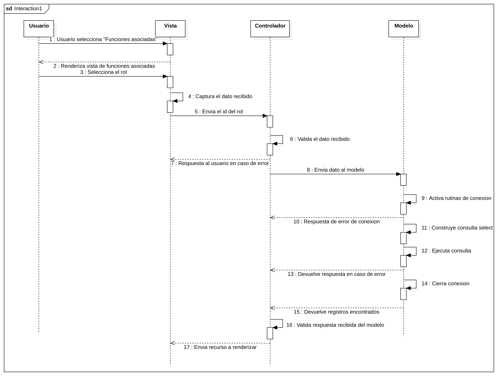
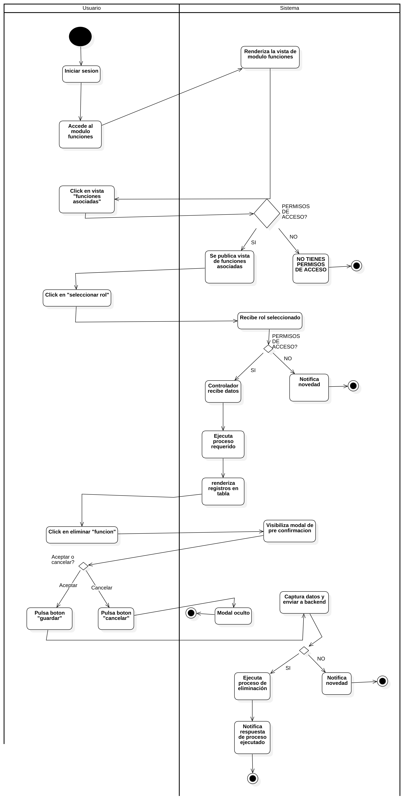
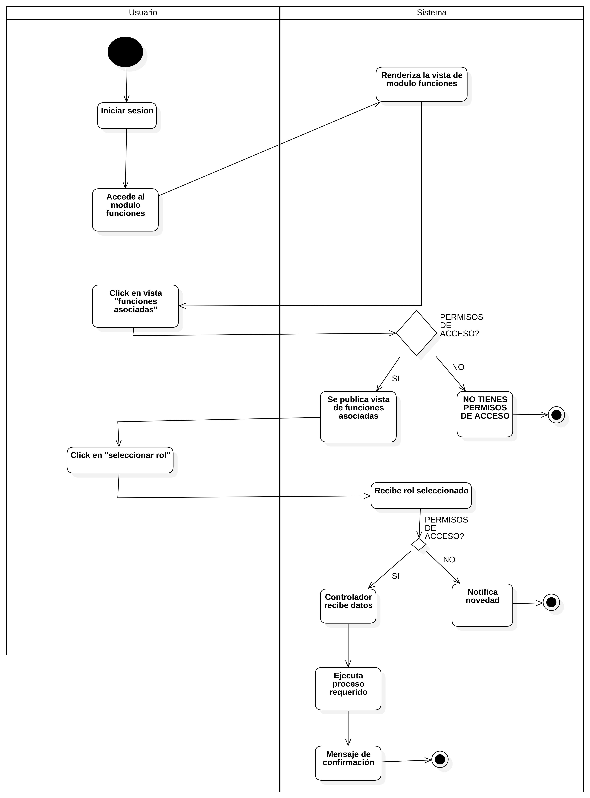
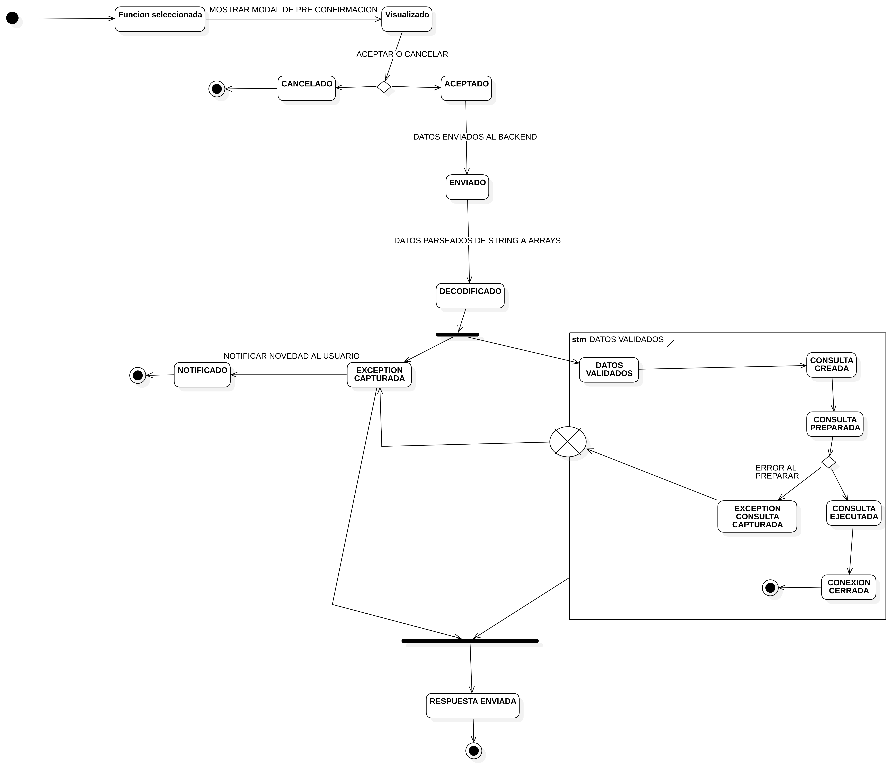

# Modulo Funciones

---

## Menú principal

- [Modulo Funciones](#modulo-funciones)
  - [Menú principal](#menú-principal)
  - [Descripción](#descripción)
  - [Arquitectura Interna (Pre-documentación)](#arquitectura-interna-pre-documentación)
  - [Dependencias de Base de Datos](#dependencias-de-base-de-datos)
  - [Documentación del sistema](#documentación-del-sistema)
    - [Requerimientos](#requerimientos)
    - [Historias de usuario](#historias-de-usuario)
  - [Diagramas UML](#diagramas-uml)
    - [Caso de uso](#caso-de-uso)
    - [Secuencia](#secuencia)
    - [Actividades](#actividades)
    - [Estados](#estados)
  - [TODOS especificos](#todos-especificos)

## Descripción

Modulo que consiste en parametrizar y gestionar las funciones del sistema que se encuentran en los controladores del sistema, con el fin de validar la seguridad y acceso a ellas dependiendo del rol asociado.

## Arquitectura Interna (Pre-documentación)

```bash
/ [module/Funciones*] tree
.
├── Const # Carpeta con archivo php que contiene variales constantes especificas del modulo
│   └── FuncionesConst.php
├── Controller # Controladores que realizan la logica interna del modulo
│   ├── FuncionesAsociadasController.php # Controlador que interactua con la logica de las funciones asociadas AL ROL
│   ├── FuncionesMainController.php # Controlador que permite el acceso a la vista principal del modulo y sus vistas secundarias
│   └── FuncionesModuloController.php # Controlador que maneja toda la logica de las funciones que estan ASOCIADAS AL MODULO
├── Css # Recursos css para las hojas de estilo de diferentes vistas
│   ├── Funciones.css
│   ├── funcionesIndexView.css
│   └── RolesFunciones.css
├── Docs # Documentacion del sistema
│   ├── Requirements.MD
│   ├── Uml
│   │   ├── Actividades
│   │   │   ├── eliminarFuncion.jpg
│   │   │   └── verFunciones.jpg
│   │   ├── CasoUso
│   │   │   └── moduloFunciones.jpg
│   │   ├── Estado
│   │   │   └── eliminarFuncion.jpg
│   │   └── Secuencia
│   │       ├── eliminarFuncion.jpg
│   │       └── verFunciones.jpg
│   └── User_story
│       └── Eliminar_funcion.MD
├── Js # Archivo js que manipula el doom y realizar peticiones a los controladores especificos
│   └── RolesFunciones.js
├── Model # Modelo de la tabla funciones
│   └── FuncionesModel.php
├── Mysql # Script de la tabla funciones + alters que contiene las modificaciones luego de haber creado la v1 del modulo
│   ├── alters.sql
│   └── tables.sql
├── README.MD # Archivo INICIAL DE DOCUMENTACION DEL MODULO
└── views # Vistas del modulo
    ├── FuncionesAsociadas.php
    └── FuncionesIndex.php

15 directories, 22 files
```

## Dependencias de Base de Datos

- Tabla principal: `funciones`
- Tablas asociadas: `roles_funciones`, `roles`, `modulos`

---

## Documentación del sistema

### Requerimientos


### Historias de usuario

| Nombre historia      |                    Documentación                    |
| :------------------- | :-------------------------------------------------: |
| **Eliminar funcion** | [Ver README](./Docs/User_story/Eliminar_funcion.MD) |

## Diagramas UML

### Caso de uso



### Secuencia

**Ver funciones**


**Eliminar funciones**


### Actividades

**Ver funciones**


**Eliminar funciones**


### Estados

**Eliminar función**


## TODOS especificos

- [X] En vista **Funciones asociadas módulo - Funciones** IMPLEMENTAR UN CAMPO ADICIONAL EN LA TABLA QUE ME PERMITA GUARDAR LOS CONTROLADORES, ESTO PORQUE CUANDO HAY UN MODULO CON VARIOS CONTROLADORES INTERNOS NO SE A QUE CONTROLADOR HACE REFERENCIA.
- [X] Implementar radio Button para validar si es vista main o secundaria
- [X] Mover los archivos que estaban en el modulo de **ROLES** al modulo que pertenecen que son **Funciones**
- [ ] Implementar funcionalidad de log.
- [X] llamar al menu una vez se cree o se actualice
